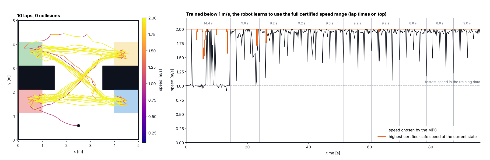
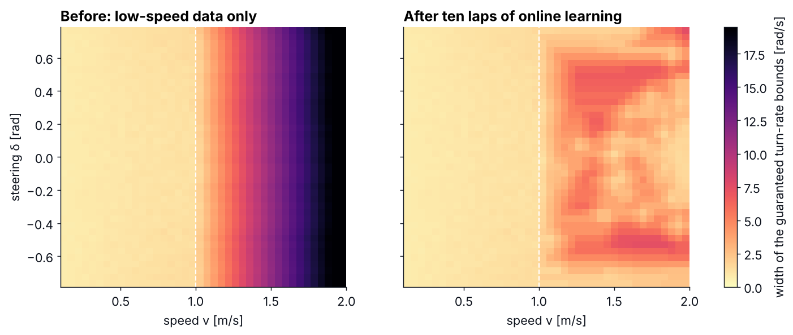
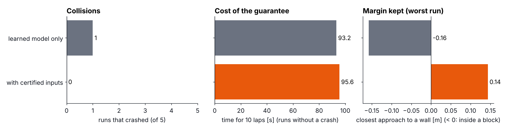
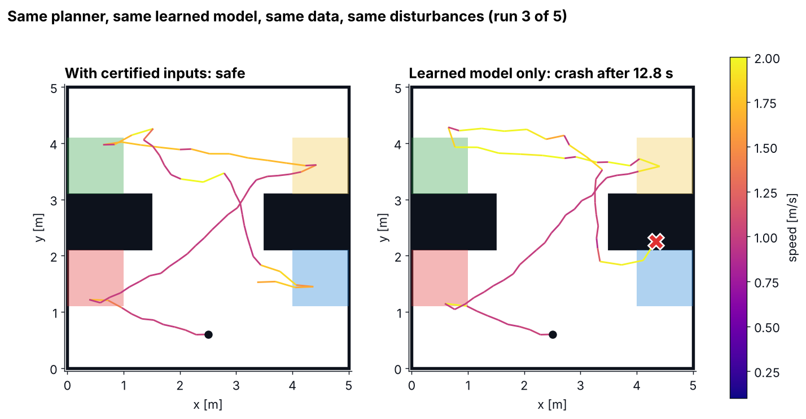

# compatible-mpc: learn while you drive, never leave the safe region

**A predictive controller that gets its performance from a model learned from data and its safety from a second, guaranteed model built from the same data. Both keep learning while the system runs.**

This package implements the *compatible models approach* of

> A. Makdesi, A. Girard, L. Fribourg. *Safe Learning-Based Model Predictive Control Using the Compatible Models Approach.* European Journal of Control, 74, 100849, 2023. [doi:10.1016/j.ejcon.2023.100849](https://doi.org/10.1016/j.ejcon.2023.100849)
>
> A. Makdesi, A. Girard, L. Fribourg. *Online Learning for Safe Model Predictive Control with the Compatible Models Approach.* IFAC ADHS 2024, pp. 147–152. [doi:10.1016/j.ifacol.2024.07.439](https://doi.org/10.1016/j.ifacol.2024.07.439)



## The idea

Learned models make a controller fast; they come with no guarantee. Robust controllers are safe; they are cautious. Here both come from the same data:

1. **Guaranteed model.** From measured transitions and known bounds on how fast the dynamics can change (bounds on the partial derivatives), compute for every grid cell an interval that is *proven* to contain the true dynamics plus disturbance.
2. **Safe actions.** On the finite abstraction this model induces, compute the maximal controlled invariant set inside the constraints and, for every state, the input cells that keep the system in it.
3. **Compatible learned model.** Fit a smooth piecewise multi-affine model, constrained to lie *inside* the guaranteed one. Because multi-affine functions take their extremes at cell vertices, this is just box constraints on the vertex values.
4. **MPC.** Plan with the learned model, but choose the first input only among the safe actions. The closed loop is recursively feasible and never leaves the safe set, however good or bad the learned model is (EJC 2023, Theorem 1).
5. **Online learning.** Every new measurement tightens the guaranteed model (by intersection, so it stays sound) and takes a projected gradient step on the learned model (so it stays compatible).

No linear model is assumed. The guarantee is deterministic, not probabilistic.

## Demo: a robot trained only at low speed learns to drive fast, safely

The ADHS 2024 case study: a car-like robot (unicycle model, 0.1 m wheelbase, disturbance ±0.05 on each velocity) must visit four zones in order, as fast as possible, in a 5 × 5 m room with two blocks. The controller does not know the equations; it gets **10,000 measurements, all below 1 m/s**, and bounds on the derivatives. Speed commands go up to 2 m/s.

```bash
pip install -e ".[examples]"               # installs ddma v0.12.0 from GitHub; Python 3.10+
python examples/four_zones_online.py      # 10 laps, about 1–2 minutes (--method cem|shooting|gradient)
python examples/make_figures.py
```

Result of the reference run (`results/four_zones_summary.json`):

| | |
|---|---|
| Laps / time | 10 laps in 96.4 s (482 control steps) |
| Collisions, steps outside the certified safe set | **0, 0** |
| Lap time | 14.4 s (lap 1) → 8.8–9.2 s (laps 3–10) |
| Mean speed | 1.14 m/s (lap 1) → 1.81–1.92 m/s (laps 2–10) |
| Learned turn-rate error at 1–2 m/s (RMS) | 5.3 rad/s before → 1.4 rad/s after |
| Width of the guaranteed turn-rate bounds at 1–2 m/s | 11.9 rad/s → 3.9 rad/s |

What learning changes: from the start, the guaranteed model already certifies speeds up to 2 m/s in most states (orange line in the figure), but the learned model is poor above 1 m/s, so the planner stays near 1 m/s. After a few seconds of data at higher speeds, the learned model becomes accurate there and the planner uses the full certified range.



### With and without the guarantee

Same planner, same learned model and online learning, with and without the certified input set (5 seeds × 10 laps, `python examples/compare_with_baseline.py`):



Without the certified inputs, the planner trusts its learned model, which is still wrong at high speed early on. In one of the five runs it drove into a block 12.8 s after the start; in the others it came within 4 cm of a wall. With the certified inputs there was no collision in any run, at a cost of about 2.5 % in lap time.



## Performance

| Step | Paper (MATLAB) | compatible-mpc |
|---|---:|---:|
| Guaranteed-model update, per new measurement | 1.7 ms (window 11 × 11) | about 0.1 ms over the whole 40 × 40 grid (`ddma.GrowthMap`) |
| Learned-model update, per new measurement | 80 ms | about 1.5 ms for all three outputs, including the guaranteed models |
| Maximal safe set, 50 × 50 × 40 states × 40 × 40 inputs | 424 s | under 0.1 s (plus a one-off numba compilation of a few seconds, cached) |
| One MPC step (cross-entropy method, 2,000 plans, horizon 5) | – | about 20 ms |

*compatible-mpc timings: medians over the reference run, rounded (they vary by about 30 % between runs). Paper timings: as reported in ADHS 2024 (MATLAB).*

What makes it fast:

- **Growth cones, from ddma.** Every data point bounds the unknown function by a cone. `ddma.GrowthMap` keeps the tightest bounds at the grid vertices and on each point's slabs of cells; because the cone is a sum of one-dimensional terms, a new point is evaluated on the whole grid with a few vectorized outer sums, and the cell bounds follow in one pass.
- **Translation-invariant abstraction.** For a planar vehicle the successor box of a cell is the cell shifted by integer offsets that depend only on (heading cell, input cell). The fixed point never stores successor sets: it tests boxes against 3-D summed-area tables (with a doubled heading axis for wrap-around) and keeps a witness input per state, in a numba kernel.
- **Box-constrained fitting.** The offline compatible fit is a sparse bounded least-squares problem whose size depends on the grid, not on the amount of data.

## Optimizers

The safe input set C_F(x) is a union of input cells, usually non-convex and disconnected. All three optimizers keep the first input in a safe cell, so all three are equally safe; they differ in how well they optimize.

| `method=` | how it works |
|---|---|
| `"cem"` (default) | cross-entropy method: sample plans from a Gaussian, refit it to the best 10 %, repeat 5 times; first inputs projected onto the nearest safe cell |
| `"shooting"` | random shooting: 600 random plans, then two rounds of local perturbations around the best one |
| `"gradient"` | per safe cell: the 8 most promising cells, projected gradient descent with the first input bounded to the cell's box (all cells in one batch) |

Benchmark (`python examples/compare_planners.py`): open loop on the same 200 states, cost of the returned plan compared with a long CEM run (60,000 plans per state); closed loop, 3 seeds × 10 laps.

| | `cem` | `shooting` | `gradient` |
|---|---:|---:|---:|
| Cost above best known (median / worst 10 %) | **1.4 % / 3.6 %** | 2.3 % / 8.3 % | 2.0 % / 6.2 % |
| Mean lap time, laps 3–10 | **9.0 s** | 9.8 s | 9.6 s |
| Collisions, steps outside the safe set | 0, 0 | 0, 0 | 0, 0 |
| Time per step (median) | 17 ms | **12 ms** | 72 ms |

The kinks of the piecewise model, of the cells and of the distance field make gradients unreliable here, which is why the gradient method gains little over random shooting.

## Tests

`pytest` checks the guarantees rather than only the outputs:

- the guaranteed models of the robot (`ddma.GrowthMap`, tested in ddma itself on random functions in 1–3 dimensions) contain the true velocities plus every disturbance, on 50,000 random points; the EJC model and its intersection with them too;
- the estimate is compatible after the offline fit and after every online step, checked on 20,000 random points per test;
- the computed safe set is invariant and maximal (checked independently with explicit array slicing);
- from random certified states, a random safe input keeps the *true* robot, with random disturbance, inside the safe set (3,000 trials);
- refined models never shrink the safe set;
- in closed loop, for each of the three optimizers, every MPC input is in a safe cell and the robot never collides.

## Package

| module | contents | source |
|---|---|---|
| `GrowthMap` (from [ddma](https://github.com/anas-makdesi/ddma)) | guaranteed interval model per cell from growth cones; `update` (exact, one point at a time online), `update_local` (windowed) | ADHS 2024, eqs. (7)–(10); thesis Ch. 3 |
| `monotone_split_model`, `intersect` | the EJC model: two monotone problems solved with the minimal simulating maps of ddma; intersection of two guaranteed models | EJC 2023, Prop. 2; TAC 2024 |
| `CompatibleEstimate` | piecewise multi-affine estimate: bounded least-squares fit, online projected gradient | EJC 2023, Prop. 5; ADHS 2024, Section 4.2 |
| `PlanarSafetyController` | maximal controlled invariant set and safe inputs for planar vehicles with periodic heading | |
| `CompatibleMPC` | MPC with the first input restricted to safe cells; optimizers `cem` (default), `shooting`, `gradient` | EJC 2023, Theorem 1 |
| `robots` | unicycle model, four-zone arena, shortest-path cost-to-go | ADHS 2024, Section 5 |

## Implementation notes

- **Derivative bounds.** The bounds are computed over the whole input range: with speeds up to 2 m/s, the derivative of v·cos θ with respect to θ is bounded by 2 (`Unicycle.derivative_bounds`).
- **Guaranteed model.** Each new point updates every cell, using the separable formula, which keeps the model as tight as possible at little cost. The windowed update of the ADHS 2024 paper is available with `window=`.
- **Learned model.** The offline fit adds a small smoothness term so that grid vertices without data get sensible values (`smooth=0` solves the problem exactly as in the EJC 2023 paper). The online step is normalized by the size of the gradient.
- **Optimizer.** The first input is only ever drawn from, or projected onto, the safe input cells, so the constraint u(0|t) ∈ C_F(x) holds by construction for any optimizer; the default is the cross-entropy method (see *Optimizers*). A shortest-path cost-to-go guides the short horizon around the blocks.
- **Predicted-state constraint.** x(i|t) ∈ X_s is a penalty larger than any feasible cost: a plan whose predictions stay in the invariant set always beats one that does not.
- **Minimum speed.** The robot never stops (v ≥ 0.1 m/s), as in the papers' setting.

## Next

- The offline obstacle-avoidance case study of EJC 2023 as a second example.
- Exploration that is aware of the guarantee: choose where to collect data to grow the safe set fastest.
- A generic (non-planar) safety backend built on ddma's `SymbolicAbstraction`, and a Gymnasium wrapper.

## Authors and credits

Methods: Anas Makdesi, Antoine Girard, Laurent Fribourg. Implementation: Anas Makdesi.

This package was rewritten from the original MATLAB research code with the help of Claude (Anthropic): the Python package, the fast safety kernel, the tests and the online demo.

License: MIT.
